<!-- Banner: edit texts in scripts/build_header.py, then run `python scripts/build_header.py` -->

  

<!-- Badges -->

  
  
  

 

<table>
<tr>
<td width="58%" valign="top">

### 👋 Hi, I'm Marc!

I'm a 7th-semester **B.Sc. Business Informatics (Wirtschaftsinformatik)** student at the **University of Rostock** and a Working Student in IT Governance & Compliance at SkenData GmbH.

My work sits at the intersection of software development, process automation, and IT security. I enjoy building practical pipelines, automating workflows, and exploring how modern AI tools can solve real-world engineering problems.

-  **Interests:** AI, Cybersecurity & Software Engineering
-  **Currently:** Working on IT compliance automation (ISO 27001 / DORA) & Python tooling
-  **Next up:** Mandatory 3-month software/tech internship in Spring 2027

</td>
<td width="42%" valign="top">

### ⚡ At a Glance

| | |
|---|---|
| 🎓 | B.Sc. Business Informatics @ University of Rostock |
| 📍 | Rostock, Germany |
| 💬 | German, English, Portuguese |
| ⭐ | AI, Cybersecurity, Software Engineering |
| 📫 | marcemmerz21@gmail.com |

</td>
</tr>
</table>

### 🧰 Tech Stack & Tools

  <b>Languages & Frameworks</b> 
  

  <b>Tools & Environment</b> 
  

### 📌 Featured Projects

<table>
<tr>
<td width="50%" valign="top">

#### 🎬 Automated Content Pipeline
Modular Python pipeline for extracting, transcribing, and subtitling short-form video clips locally using Whisper, Ollama, and FFmpeg.

`Python` `Whisper` `FFmpeg`

➜ <a href="https://github.com/WMarcW/content_pipeline">View Repository</a>

</td>
<td width="50%" valign="top">

#### 📚 BeliBase Data Pipeline
Automated academic corpus builder integrating DOI regex extraction, OpenAlex/CrossRef enrichment, Playwright retries, and SQLite storage.

`Python` `Playwright` `SQLite`

➜ <a href="https://github.com/WMarcW/belibase_ap2">View Repository</a>

</td>
</tr>
</table>

### 📊 GitHub Activity

<!-- Cards are regenerated daily by .github/workflows/profile.yml -->

  <picture>
    <source media="(prefers-color-scheme: dark)" srcset="assets/generated/stats-dark.svg">
    
  </picture>
  <picture>
    <source media="(prefers-color-scheme: dark)" srcset="assets/generated/langs-dark.svg">
    
  </picture>

<picture>
  <source media="(prefers-color-scheme: dark)" srcset="assets/generated/snake-dark.svg">
  
</picture>

Updated automatically via GitHub Actions

