<!-- Banner: Texte in scripts/build_header.py eintragen, dann `python scripts/build_header.py` -->

  

<!-- Badges: Link + Beschriftung ersetzen. Weitere Logos: https://simpleicons.org -->

  
  
  
  

 

<table>
<tr>
<td width="58%" valign="top">

### 👋 [Überschrift Abschnitt 1]

[Fließtext, 2–3 Sätze]

[Fließtext, 1–2 Sätze]

- 🎯 **[Stichwort]:** [Text]
- 🛠️ **[Stichwort]:** [Text]
- 🔭 **[Stichwort]:** [Text]

</td>
<td width="42%" valign="top">

### ⚡ [Überschrift Abschnitt 2]

| | |
|---|---|
| 🎓 | [Text] |
| 📍 | [Text] |
| 💬 | [Text] |
| ⭐ | [Text] |
| 📫 | [Text] |

</td>
</tr>
</table>

### 🧰 [Überschrift Abschnitt 3]

<!-- Icon-Kürzel kommagetrennt eintragen, Liste: https://skillicons.dev -->

  <b>[Zwischenüberschrift]</b> 
  

  <b>[Zwischenüberschrift]</b> 
  

### 📌 [Überschrift Abschnitt 4]

<table>
<tr>
<td width="50%" valign="top">

#### [Emoji] [Projektname 1]
[Beschreibung, 2–3 Sätze]

`[Tag]` `[Tag]` `[Tag]`

➜ <a href="[LINK]">[Linktext]</a>

</td>
<td width="50%" valign="top">

#### [Emoji] [Projektname 2]
[Beschreibung, 2–3 Sätze]

`[Tag]` `[Tag]` `[Tag]`

➜ <a href="[LINK]">[Linktext]</a>

</td>
</tr>
</table>

### 📊 [Überschrift Abschnitt 5]

<!-- Karten werden täglich von .github/workflows/profile.yml erzeugt -->

  <picture>
    <source media="(prefers-color-scheme: dark)" srcset="assets/generated/stats-dark.svg">
    
  </picture>
  <picture>
    <source media="(prefers-color-scheme: dark)" srcset="assets/generated/langs-dark.svg">
    
  </picture>

<picture>
  <source media="(prefers-color-scheme: dark)" srcset="assets/generated/snake-dark.svg">
  
</picture>

[Fußzeile]

